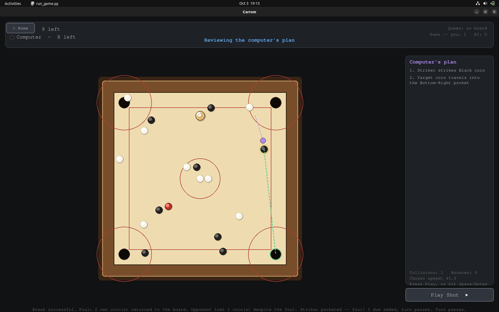

# Carrom Strategy Engine

The decision-making part of a carrom-playing robot. Given the positions of all coins on the board, it works out the best shot: **where to place the striker, which direction to hit, and how fast.** The repo also includes a playable desktop game, so you can test the engine by playing against it.

This is the **strategy module** of a research project to build a robot that can physically play carrom against humans.

> Supervised by **Dr. Nagamanikandan G**, Indian Institute of Information Technology, Design and Manufacturing (IIITDM), Kancheepuram.
> Author of this module: **Vihaan Gupta**.



## The project

The goal is a robot that plays real carrom on a real board against a human opponent. The work is split across three students:

| Part | What it covers | Who |
|---|---|---|
| Mechanical | The robot, striker mechanism and hardware | Two other students (ongoing) |
| Perception | See the board and locate every coin, see [carrom-perception-stack](https://github.com/Vihaan30g/carrom-perception-stack) | Vihaan Gupta |
| **Strategy** | **Decide the best shot (this repo)** | **Vihaan Gupta** |

```
 Overhead webcam ──► PERCEPTION ──► STRATEGY ENGINE (this repo) ──► Robot (mechanical team)
                     coin positions   position, direction, speed
```

## What this module does

The camera tells the robot where the coins are; this engine tells it what to do about it. It takes a snapshot of the board and returns a single `Shot`:

| Field | Meaning |
|---|---|
| `striker_position` | Where to place the striker along the baseline |
| `direction` | Unit vector to fire it in |
| `chosen_speed` | Launch speed (with a `speed_min` / `speed_max` bracket) |
| `chain` | Optional: the full plan (coins involved, wall bounces, target pocket), useful for visualising why a shot was chosen |

The approach is **rule-based and geometric**: it computes shots from physics rather than learning them. A reinforcement-learning version is the next stage (see below).

### How a shot is chosen

The engine is a *generate, filter, rank, solve-speed* pipeline:

```
BoardState -> candidate shots -> best one -> speed -> Shot
              (geometry-checked)  (ranked)
```

1. **Ghost-ball geometry.** To send a coin toward a pocket, the striker's centre must be at one exact point at the moment of contact, found from the target's position, the direction it must travel, and the two radii.
2. **Chains built backwards.** A plan starts at the pocket and works back to the striker. The engine considers direct shots (striker, coin, pocket) and two-coin combination shots (striker, coin, coin, pocket).
3. **Wall banks.** A coin or the striker may bounce once off a wall. The bounce point is solved using the real reflection law with the wall's restitution, rather than a simple mirror image.
4. **Striker placement by shadow-casting.** Along the baseline, the engine computes exactly which positions have a clear line to the aiming point (no other coin in the way) and picks the one with the gentlest cut angle.
5. **Obstruction checks.** Every leg is verified to be clear of all other coins.
6. **Ranking.** Candidates are scored on fewer collisions, fewer bounces, head-on hits, shorter paths, and avoiding the queen too early.
7. **Speed solving.** Working backwards through the chain, the engine accounts for constant sliding friction, the momentum and restitution of each collision, and energy lost at walls, to find the launch speed that just carries the coin into the pocket.
8. **Fallback.** If nothing works, it still returns a sensible best-effort shot and never fails.

Full details with the formulas: [`strategy_engine/ALGORITHM.md`](strategy_engine/ALGORITHM.md).

## Repository structure

```
carrom-strategy-engine/
├── run_game.py            launches the playable game
├── requirements.txt
├── strategy_engine/       the "brain": pure Python, no pygame or pymunk
│   ├── engine.py          get_best_shot(): the one public function
│   ├── graph_builder.py   builds candidate shot chains
│   ├── banking.py         wall-bounce solving
│   ├── obstruction.py     collision-free path checks
│   ├── path_ranking.py    scores candidates
│   ├── speed_solver.py    friction and collision speed maths
│   ├── geometry.py        vector helpers
│   ├── models.py          BoardState, Coin, Shot...
│   ├── config.py          board, physics and search parameters
│   ├── ALGORITHM.md       step-by-step explanation
│   └── tests/
├── game/                  the playable simulator (pygame + pymunk)
│   ├── sim_world.py       real-time physics world
│   ├── match.py           rules referee (ICF-style)
│   ├── screens.py         home, settings, rules and game screens
│   ├── board_render.py    drawing
│   └── ...
└── assets/                README images
```

The two folders are deliberately independent. `strategy_engine/` knows nothing about graphics or physics libraries, so it can be dropped into any simulator or a real robot controller. `game/` only calls it for the computer's moves.

## Try it: play against the engine

```bash
git clone https://github.com/Vihaan30g/carrom-strategy-engine.git
cd carrom-strategy-engine
pip install -r requirements.txt
python3 run_game.py
```

The home page offers **Play as White**, **Play as Black**, **Settings** (friction, restitution, coin and striker mass), **Rules** and **Quit**.

**Controls**

- **Left-click and drag** the striker to slide it along your baseline.
- **Right-click on the striker, drag back and release** to shoot. The pull-back sets the direction (slingshot style) and distance sets the power; a gauge shows how strong the shot is.

Every stroke, yours or the computer's, plays out in real time with full coin-to-coin and coin-to-wall collisions. The computer's moves come from `get_best_shot`.

## Using the engine in your own code

```python
from strategy_engine import (BoardState, Coin, CoinColor, Striker,
                             get_best_shot, DEFAULT_CONFIG)

cfg = DEFAULT_CONFIG
board = BoardState(
    coins=[...],                       # list of Coin(id, color, pos, radius)
    striker=Striker(pos=(37, 8), radius=cfg.striker.radius),
    current_player_color=CoinColor.WHITE,
)
baseline = (cfg.striker_zone.line_p1, cfg.striker_zone.line_p2)

shot = get_best_shot(board, cfg, baseline=baseline)
print(shot.striker_position, shot.direction, shot.chosen_speed)
```

Units are centimetres, grams and seconds. Board and coin dimensions follow ICF standards and can all be changed in `strategy_engine/config.py`.

## Where this is heading: reinforcement learning

The rule-based engine is the foundation. The next stage is **reinforcement learning**, with training planned in a physics simulator such as MuJoCo or Isaac Lab, so the robot can learn shots that go beyond hand-written geometry. The engine is already structured for this: `BoardState` is a clean, serialisable state, the ranked candidate list can serve as an action set for a policy, and `get_best_shot` accepts an optional `target_coin_id` to focus on one coin.

This part is under active development.

## License and use

This is an ongoing research project under Dr. Nagamanikandan G at IIITDM Kancheepuram. The code is published **for viewing and evaluation only**. It may not be copied, modified, redistributed or used without written permission. See [LICENSE](LICENSE).

## Author

**Vihaan Gupta** · [GitHub](https://github.com/Vihaan30g) · vihaan30g@gmail.com
